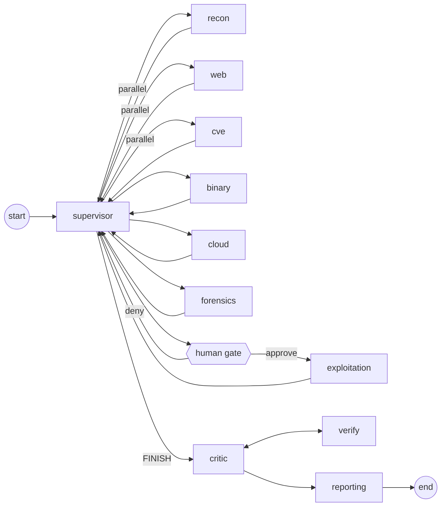
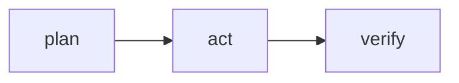
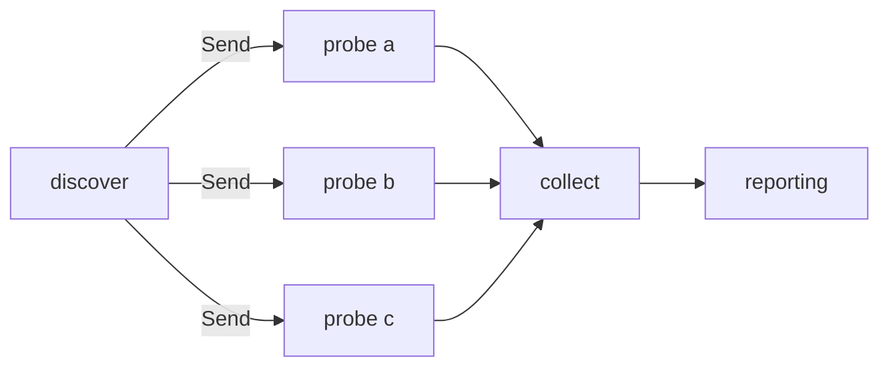

# PepperSpray

[](https://github.com/hacKarim/pepperspray-mcp/actions/workflows/ci.yml)
[](./LICENSE)


LangGraph multi-agent security assessment. CLI + MCP server. 114 tools.

> ⚠️ Authorized targets only. Active runs need `--authorized`.

## Graph



Each specialist:



Parallel scan:



## Run

Example output, abridged.

```console
$ pepperspray run --target http://juice-shop:3000 --authorized --stream
▶  Streaming assessment of http://juice-shop:3000 (thread: assessment)
  → supervisor
  → cve      (+2 findings)
  → recon    (+5 findings)     ← same superstep
  → web      (+4 findings)
  → supervisor

⏸  Paused before exploitation-class actions (exploitation).
    Approve exploitation-class actions against this target?

$ pepperspray resume assessment --stream
  → exploitation_gate
  → exploitation  (+1 findings)
  → supervisor
  → critic
  → verify
  → critic
  → reporting
```

```console
$ pepperspray chain parallel_scan --target example.com \
    --subtargets "a.example.com,b.example.com,c.example.com" --authorized
```

## Features

- Supervisor routing
- Parallel specialists
- `Send` fan-out
- Human approval gate
- Critic reflection
- Nested subgraphs
- SQLite checkpoints
- Resume, time-travel
- Live streaming
- Retry + cache
- LangSmith (opt-in)
- Argv-only execution

## Commands

| Command | Does |
|---|---|
| `run` | Full assessment |
| `chain <name>` | Fixed workflow |
| `resume <thread>` | Approve / deny |
| `history <thread>` | Checkpoint timeline |
| `list-tools` | Tool registry |
| `mcp` | MCP server |

## Quick start

```bash
cp .env.example .env        # ANTHROPIC_API_KEY
docker compose build
docker compose run --rm pepperspray pepperspray run --target <url> --authorized
```

MCP client:

```json
{ "mcpServers": { "pepperspray": {
  "command": "docker",
  "args": ["run", "--rm", "-i", "-e", "ANTHROPIC_API_KEY", "pepperspray:2.0.0"] } } }
```

## Dev

```bash
pip install -e ".[dev,openai,ollama]"
ruff check pepperspray tests && black --check pepperspray tests && pytest -q
```

## License

[MIT](./LICENSE)
